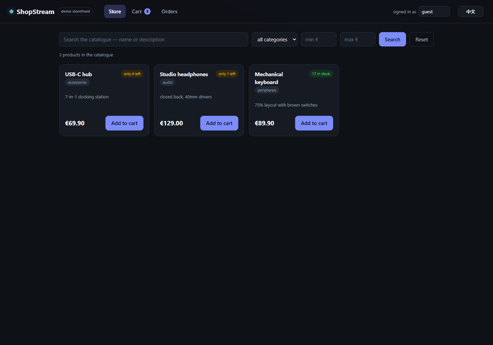
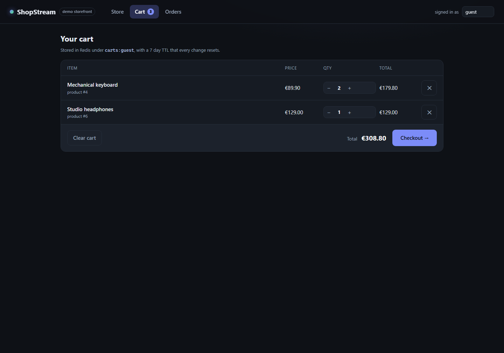
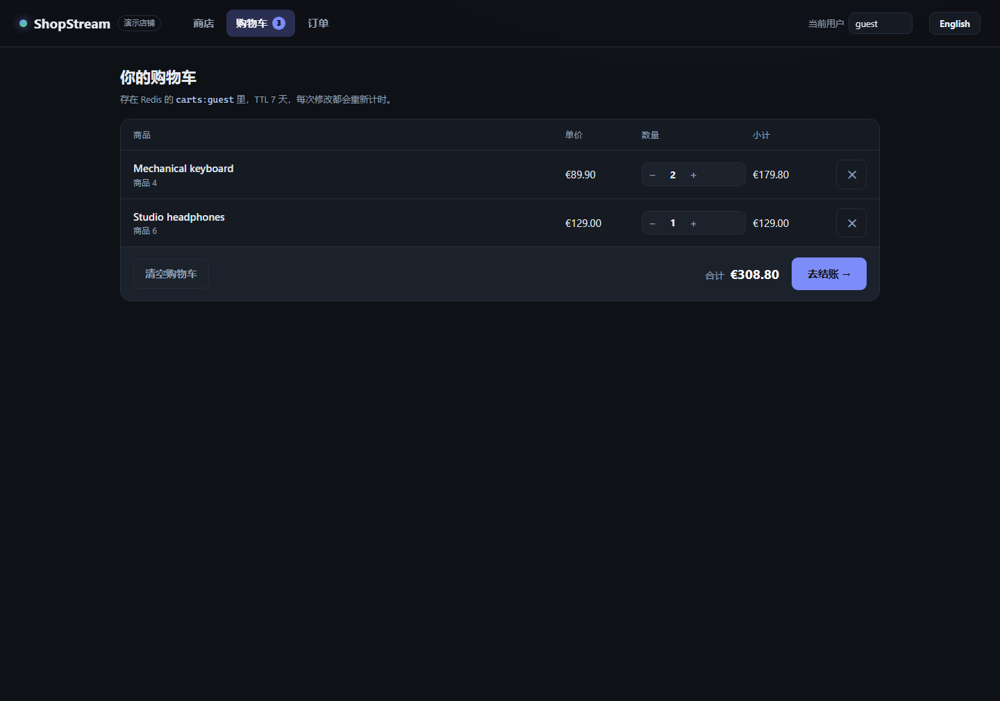
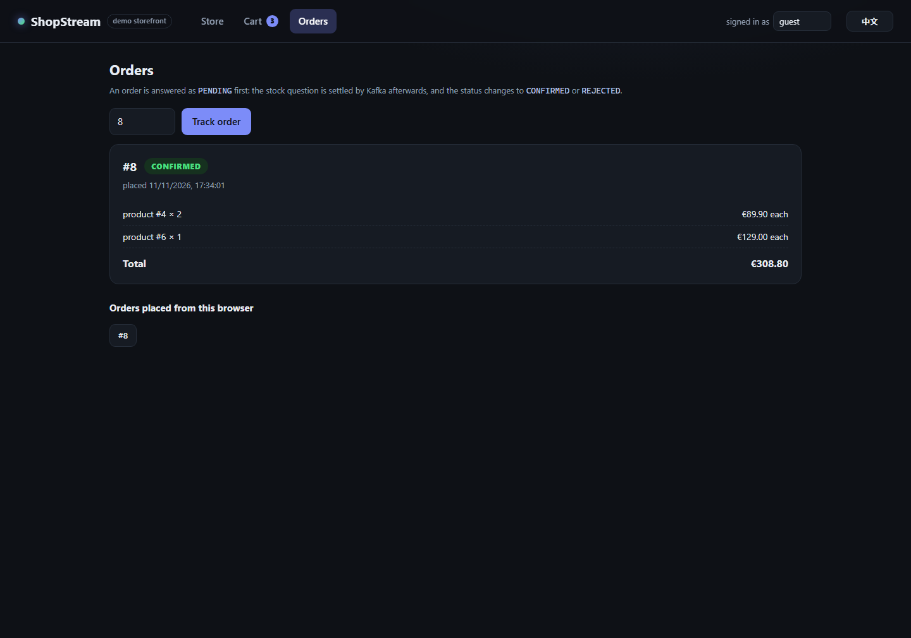
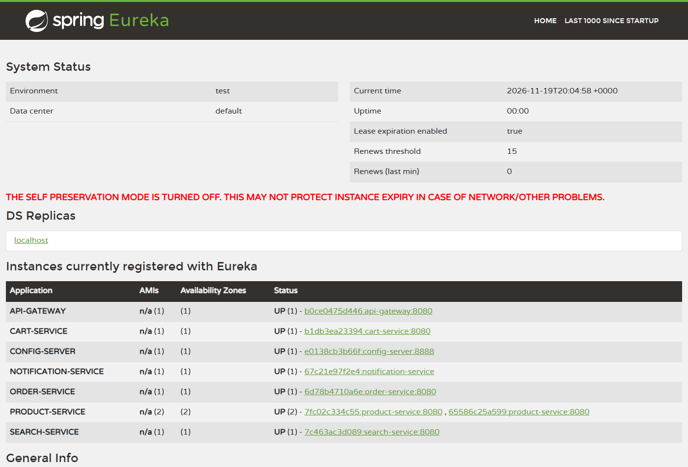

# ShopStream

Distributed e-commerce platform for the *Development of Distributed Web Applications* semester project.

**Current state: Step 5 — Spring Cloud.** Seven Spring Boot applications, one KRaft Kafka broker, one
Elasticsearch node, one Redis and a small web page. Orders are confirmed or rejected asynchronously
through events, stock is decremented exactly once, the catalogue is searchable with full-text queries and
filters, carts live in Redis with a TTL and are only emptied when the order they produce is confirmed, and
the hot product reads are cached. Above all that sits Spring Cloud: one gateway is the only published
port, Eureka is how the services find each other, a config server hands out the configuration, and
service-to-service calls are Feign interfaces that name a service, not a host.



Open **<http://localhost:8080>** after `docker compose up`: that is the whole system in a browser —
browse the catalogue, add to the cart, check out and watch the order come back `CONFIRMED`.
The page is bilingual (English / 中文, button in the top right corner, or `?lang=zh` in the URL).

## Services

Only **one** port is published to the host: `8080`, the gateway. Everything else lives on the compose
network and is reachable only by name — which is exactly what Step 5 asks for. Every URL in the examples
below therefore goes through the gateway.

| Service | Published | Port inside the network | Role |
|---|---|---|---|
| api-gateway | **8080** | 8080 | the single entry point: routing, request id |
| frontend | — | 80 | the storefront page (nginx, static) |
| product-service | — | 8080 (×2 instances) | product CRUD, reserves stock |
| order-service | — | 8080 | places orders, tracks their state |
| cart-service | — | 8080 | carts per user, checkout into an order |
| search-service | — | 8080 | full-text product search, filters, pagination |
| notification-service | — | — | writes one simulated e-mail per finished order |
| discovery-server | — | 8761 | Eureka registry |
| config-server | — | 8888 | hands out the configuration from `config-repo/` |
| elasticsearch | — | 9200 | single node, `products` index |
| redis | — | 6379 | carts (with TTL) and the product read cache, password protected |
| mysql-product / mysql-order | — | 3306 | one database per service, never shared |
| kafka | — | 9092 | single broker, KRaft mode (no ZooKeeper) |

## Run

```bash
cp .env.example .env          # once, then edit the passwords if you like
docker compose up --build
```

First start takes a few minutes: the image builds run Maven inside the container, so **no local JDK is required**.

Check that it is up:

```bash
curl http://localhost:8080/actuator/health      # the gateway
curl http://localhost:8080/api/products         # through the gateway
docker compose ps                               # every container, and the only published port
```

or simply open <http://localhost:8080>.

Give it **about half a minute after `up`**: a freshly started gateway begins with an empty registry and
only learns where `product-service` lives on its first Eureka fetch, so the first requests can still
answer `503 Unable to find instance for product-service`. That is the cost of service discovery, not a
broken route — see "The first thirty seconds" below.

The Eureka dashboard is not published on purpose (it is not part of the system). To look at it anyway:

```bash
docker compose -f docker-compose.yml -f docker-compose.dev.yml up -d
open http://localhost:8761
```

`docker-compose.dev.yml` only adds host ports for the registry and for a Kafka client; it changes no
configuration, and `docker compose up -d` without it puts the stack back to one published port.

Stop (keep the data):

```bash
docker compose down
```

Stop and wipe the databases, the Kafka log and the carts:

```bash
docker compose down -v
```

## The storefront

`frontend/` is one HTML page, one stylesheet, one script — no build step, no npm, no framework:

| View | What it shows |
|---|---|
| Store | the catalogue from search-service, with the search box, category filter and price window |
| Cart | the cart from cart-service, quantities editable, checkout, and what happened to the order |
| Orders | one order by id, its status and its lines, live while it is `PENDING` |

The page is served by nginx as four static files, and nginx forwards nothing: the page calls
`/api/products`, `/api/orders`, `/api/carts` and `/api/search` on its own origin, and **api-gateway**
routes each prefix to the service that owns it. **The browser therefore only talks to one port**, so not a
single service needs a CORS rule, and the page was written against the gateway's URLs before the gateway
existed — the nginx proxy it used in Steps 1–4 was removed in Step 5 rather than left in place, because
two proxies in a row would hide the layer the project is supposed to demonstrate.

The interesting part for the architecture: the cart stores product ids only, so the cart view asks
product-service for each name and price as it renders. That is the same read model an e-commerce site
has — a cart is a list of references, not a copy of the catalogue.

The page is bilingual: every string comes from one dictionary in `app.js`, the static markup carries
`data-i18n` keys, and switching language re-renders whatever is on screen instead of reloading. The
choice is remembered in `localStorage`, the first visit follows `navigator.language`, and `?lang=zh`
/`?lang=en` overrides both — handy when the same laptop has to show the demo to two audiences.







## The order flow

```
client ──POST /api/orders──> api-gateway ──lb://order-service──> order-service
                             │  @FeignClient product-service: GET /products/{id}
                             ▼
                        product-service
                             │
   order-service saves the order as PENDING
                             │
              ┌──────────────┴──────────────┐
              │  order-events (key=orderId) │
              └──────────────┬──────────────┘
                             ▼
                     product-service
              reserves stock in one transaction
              (idempotent, see below)
                             │
             ┌───────────────┴────────────────┐
             │ inventory-events (key=orderId) │
             └───────────────┬────────────────┘
                 ┌───────────┴───────────┐
                 ▼                       ▼
           order-service          notification-service
     CONFIRMED / REJECTED            simulated e-mail
```

`POST /orders` therefore answers **before** the stock question is settled: it returns `PENDING`.
`GET /orders/{id}` a moment later returns `CONFIRMED` (stock was reserved) or `REJECTED`
(the product is unknown or there is not enough stock).

### Topics

| Topic | Key | Partitions | Events | Produced by | Consumed by |
|---|---|---|---|---|---|
| `order-events` | orderId | 3 | `OrderPlaced`, `OrderConfirmed`, `OrderRejected` | order-service | product-service, notification-service |
| `inventory-events` | orderId | 3 | `StockReserved`, `StockRejected` | product-service | order-service, notification-service |
| `product-events` | productId | 3 | `ProductCreated`, `ProductUpdated`, `ProductDeleted` | product-service | search-service |

The topics are declared in code (`KafkaTopicConfig` with `TopicBuilder`) and the broker runs with
`KAFKA_AUTO_CREATE_TOPICS_ENABLE=false`, so the partition count is always the one we chose rather than
the broker default of one.

One topic carries three record types, so the topic name alone does not say what a consumer was given:
the JSON `__TypeId__` header decides which of the three records the deserializer builds, and every
listener switches on the value it receives. product-service acts on `OrderPlaced` and ignores the two
answers that it produced itself; notification-service remembers `OrderPlaced` and writes the e-mail
when `OrderConfirmed` or `OrderRejected` arrives. All three events of one order share the order id as
key, so they land on the same partition and are consumed in the order they happened — the mail always
knows the content of the order before its status.

## Spring Cloud — how the services find each other

Four components, one job each: a registry that says *where*, a config server that says *with what
settings*, Feign that turns a service name into a call, and a gateway that is the only way in.

### discovery-server — a registry, not a router

```java
@SpringBootApplication
@EnableEurekaServer
public class DiscoveryServerApplication { ... }
```

It listens on 8761, does not register itself (`eureka.client.register-with-eureka: false`) and does not
fetch a registry of its own (`fetch-registry: false`) — it *is* the registry. Self-preservation is off, so
a dead instance disappears in ~90 s instead of being kept forever: for a demo that is stopped and started
by hand, an honest registry beats a forgiving one.

Every other application is a client (`spring-cloud-starter-netflix-eureka-client`) with

```yaml
eureka:
  client:
    service-url:
      defaultZone: ${EUREKA_DEFAULT_ZONE:http://discovery-server:8761/eureka/}
  instance:
    prefer-ip-address: true
```

`prefer-ip-address` matters in Docker: the container hostname is only resolvable from inside the compose
network, and the gateway is a client of the same registry, so registering the container IP keeps the
address usable by everyone.



`PRODUCT-SERVICE (2)` is the point of the exercise: two containers of the same image are one logical
service, and both the gateway's `lb://product-service` route and order-service's Feign client round-robin
over those two addresses without either of them knowing an IP.

### config-server — configuration outside the images

```java
@SpringBootApplication
@EnableConfigServer
public class ConfigServerApplication { ... }
```

```yaml
spring:
  profiles:
    active: native
  cloud:
    config:
      server:
        native:
          search-locations: file:/config-repo
```

`config-repo/` is a plain folder of YAML files in the repository and compose mounts it read-only into the
container. A git backend would be one property away (`spring.cloud.config.server.git.uri`), but the
project has to build and run without a network, and a folder has the same shape: one shared
`application.yml` plus one file per `spring.application.name`.

What is left in each service's own `application.yml` is only the bootstrap:

```yaml
server:
  port: ${SERVER_PORT:8080}
spring:
  application:
    name: product-service
  config:
    import: "optional:configserver:http://config-server:8888"
```

`optional:` means *start anyway if the config server is not up yet* — the service then runs on the
defaults written in its own file, which are the same values. Compose still orders the start
(`depends_on: config-server: condition: service_healthy`), so in practice nobody ever sees the fallback.

Everything that used to be repeated in eight `application.yml` files moved here:

| Moved to config-repo | Why it belongs there |
|---|---|
| `spring.datasource.*` | the URL of *this* service's database, per service |
| `spring.kafka.*` serializers, trusted packages | one JSON contract for all producers and consumers |
| `spring.data.redis.*`, `spring.cache.type` | cart and product cache share one Redis |
| `spring.elasticsearch.uris` | one node, one index |
| `spring.cloud.openfeign.client.config.default.connect-timeout: 2000` / `read-timeout: 5000` | timeouts are a deployment decision, not a code decision |
| `shopstream.topics.order-events` / `inventory-events` / `product-events`, `partitions`, `replicas` | the topic names, so code has no string literals and the broker layout can change without a rebuild |

With the names in configuration, the listeners read them by placeholder instead of by constant:

```java
@KafkaListener(topics = "${shopstream.topics.order-events}", groupId = "product-service")
```

and `KafkaTopicConfig` builds the same three topics from `${shopstream.topics.*}` with
`${shopstream.topics.partitions}` — one place to rename a topic, and producer, consumer and topic
declaration all follow. The four copies of `Topics.java` are gone.

```bash
docker compose exec config-server wget -qO- http://localhost:8888/product-service/default
```

```json
{ "name": "product-service", "profiles": ["default"],
  "propertySources": [
    { "name": "file:/config-repo/product-service.yml", "source": { "spring.datasource.url": "..." } },
    { "name": "file:/config-repo/application.yml",     "source": { "eureka.client.service-url.defaultZone": "..." } } ] }
```

The second source is the shared file: that is how a single `application.yml` reaches every service
without being copied.

### Feign — calling a service by its name

order-service no longer knows a URL. The whole client is an interface:

```java
@FeignClient(name = "product-service", path = "/products")
public interface ProductFeignClient {

    @GetMapping("/{id}")
    ProductDto findById(@PathVariable("id") Long productId);
}
```

`name = "product-service"` is looked up in Eureka, and Spring Cloud LoadBalancer picks one of the two
instances per call; `path` is prefixed to every method. `@EnableFeignClients` on
`OrderServiceApplication` is what turns the interface into a bean, and the old `RestClient` with
`PRODUCT_SERVICE_URL` is deleted — there is no host name in the Java code any more.

Feign turns a non-2xx answer into a `FeignException`, and order-service's API is specified in terms of
*"product unknown"* and *"product service unavailable"*, so `FeignErrorConfig` decodes it back:

```java
@Bean
ErrorDecoder productErrorDecoder() {
    return (methodKey, response) -> switch (response.status()) {
        case 404 -> new ProductNotFoundException("product-service has no product at " + response.request().url());
        case 500, 502, 503, 504 -> new ProductUnavailableException(
                "product-service answered " + response.status() + " for " + response.request().url());
        default -> new ErrorDecoder.Default().decode(methodKey, response);
    };
}
```

so `POST /orders` still answers `404` for an unknown product and `502` for an unreachable one, exactly as
it did with `RestClient`, and the `@ControllerAdvice` did not change.

cart-service does the same towards order-service, with one addition: a `default` method on the interface
maps `CartItem` to `OrderRequest.Line`, so the cart code kept calling `orderClient.placeOrder(items)`.

### api-gateway — one door

```xml
<dependency>
  <groupId>org.springframework.cloud</groupId>
  <artifactId>spring-cloud-starter-gateway</artifactId>
</dependency>
```

Gateway is reactive (WebFlux + Netty). `spring-boot-starter-web` must **not** be on the classpath of this
module: both on it and Boot starts a servlet container, the gateway's routes are never registered, and
every request answers 404 while the log says the application started fine.

The routes are in `config-repo/api-gateway.yml`, so they are configuration, not code:

| Predicate | URI | Filter | What it is |
|---|---|---|---|
| `/api/products, /api/products/**` | `lb://product-service` | `StripPrefix=1` | product CRUD |
| `/api/orders, /api/orders/**` | `lb://order-service` | `StripPrefix=1` | orders |
| `/api/carts, /api/carts/**` | `lb://cart-service` | `StripPrefix=1` | carts |
| `/api/search, /api/search/**` | `lb://search-service` | `StripPrefix=1` | search |
| `/**` | `http://frontend:80` | — | the storefront itself |

`StripPrefix=1` is what keeps the services unchanged: they still answer `/products`, and the gateway
removes the `/api` segment before forwarding. The last route is a catch-all so the page and its assets
come through the same door; nginx is not a Spring application and cannot be in Eureka, so it is addressed
by its compose name. `spring.cloud.gateway.discovery.locator.enabled` is off, because a locator would also
publish `/PRODUCT-SERVICE/**` URLs that nobody asked for.

```bash
curl http://localhost:8080/actuator/gateway/routes
```

```
product-service  Paths: [/api/products, /api/products/**]  [[StripPrefix parts = 1]]  lb://product-service
order-service    Paths: [/api/orders, /api/orders/**]      [[StripPrefix parts = 1]]  lb://order-service
cart-service     Paths: [/api/carts, /api/carts/**]        [[StripPrefix parts = 1]]  lb://cart-service
search-service   Paths: [/api/search, /api/search/**]      [[StripPrefix parts = 1]]  lb://search-service
frontend         Paths: [/**]                              []                        http://frontend:80
```

### One id per request

`RequestIdFilter` is a `GlobalFilter` with `Ordered.HIGHEST_PRECEDENCE`, so it runs before routing:

```java
String requestId = request.getHeaders().getFirst(HEADER);
if (requestId == null || requestId.isBlank()) {
    requestId = UUID.randomUUID().toString();
}
ServerHttpRequest mutated = request.mutate().header(HEADER, requestId).build();
exchange.getResponse().getHeaders().set(HEADER, requestId);
```

An id that arrives on the request is reused, otherwise one is generated; the same value goes downstream in
the request header and back to the caller in the response header, and the filter logs the line that makes
the log useful when four services are talking:

```
GET /api/carts/guest -> 200 OK (14 ms) requestId=da6198c1-782e-49ef-8f00-0b6f97e9d0d6
GET /api/search      -> 200 OK (23 ms) requestId=033e48b5-1d00-485c-8829-263c1d1e2a4b
GET /api/orders/10   -> 200 OK (18 ms) requestId=890e8ebf-8a2a-4a01-8182-8a261ba28928
```

```bash
curl -s -D - -o /dev/null -H "X-Request-Id: demo-123" http://localhost:8080/api/products
# X-Request-Id: demo-123
```

On failure the same filter logs the reason, which is how the 503 below was diagnosed:

```
GET /api/search -> failed after 47 ms requestId=c0eeba50-... reason=NotFoundException: 503 SERVICE_UNAVAILABLE
  "Unable to find instance for search-service"
```

### The first thirty seconds

A gateway that has just started has an empty registry and learns the services on its first Eureka fetch,
so for up to ~30 s every route answers `503 Unable to find instance for …` even though the services are
healthy. Nothing is misconfigured: the routes exist (see `/actuator/gateway/routes` above), only the
address book is not filled in yet. Waiting half a minute, or retrying, is the whole fix.

The same behaviour shows up honestly when an instance dies. With two product-service containers running,
stopping one of them:

```
docker compose stop product-service        # container shopstream-product-service-1
only instance 2 alive -> 500 200 200 200 200 200
```

The first request still went to the instance that had just died — the load balancer had not refreshed its
list yet — and the next five were served by the surviving instance. That is at most one failed request per
30 s, which is a fair description of client-side discovery without a health-checking proxy in front.

## product-service — /products

```bash
# create
curl -X POST http://localhost:8080/api/products -H "Content-Type: application/json" -d '{
  "name": "Mechanical keyboard",
  "description": "75% layout, brown switches",
  "category": "peripherals",
  "price": 89.90,
  "stock": 25
}'

# list / read
curl http://localhost:8080/api/products
curl http://localhost:8080/api/products/1

# update
curl -X PUT http://localhost:8080/api/products/1 -H "Content-Type: application/json" -d '{
  "name": "Mechanical keyboard",
  "description": "75% layout, brown switches",
  "category": "peripherals",
  "price": 79.90,
  "stock": 30
}'

# delete
curl -X DELETE http://localhost:8080/api/products/1
```

## search-service — /search

product-service publishes `ProductCreated`, `ProductUpdated` and `ProductDeleted` on `product-events`
(key = productId) after every write, and search-service consumes them into the `products` index. Nothing
reads product-service's database: the index is built purely from the event stream.

The mapping is declared explicitly instead of being guessed, because the field type decides which queries
work: `name` and `description` are `text` (analysed, full-text), `category` is `keyword` (exact filter),
`price` is `double` and `stock` an `integer` (range filters).

```bash
# everything (default page size 10)
curl "http://localhost:8080/api/search"

# full text over name and description
curl "http://localhost:8080/api/search?q=keyboard"

# only one category, only a price window, page 0, 5 per page
curl "http://localhost:8080/api/search?category=peripherals&minPrice=50&maxPrice=100&page=0&size=5"
```

```json
{
  "total": 1,
  "page": 0,
  "size": 10,
  "items": [
    { "id": 4, "name": "Mechanical keyboard", "description": "75% layout with brown switches",
      "category": "peripherals", "price": 89.9, "stock": 25 }
  ]
}
```

All filters are optional and combine: `q` matches name **or** description, `category` is an exact term,
`minPrice`/`maxPrice` bound the price. `page` starts at 0, `size` is capped at 100, and a nonsense request
(`size=0`, `minPrice > maxPrice`) answers `400` with a problem+json body.

## order-service — /orders

`POST /orders` takes a list of `productId` + `quantity`. The prices are **not** sent by the client:
order-service asks product-service for each price (a Feign call to `product-service`, resolved through
Eureka) and computes the total.

```bash
curl -X POST http://localhost:8080/api/orders -H "Content-Type: application/json" -d '{
  "items": [
    { "productId": 1, "quantity": 2 },
    { "productId": 2, "quantity": 1 }
  ]
}'

curl http://localhost:8080/api/orders/1
```

Response of the POST (the GET looks the same, but with the settled status):

```json
{
  "id": 1,
  "status": "PENDING",
  "totalPrice": 259.70,
  "createdAt": "2026-11-04T18:00:00Z",
  "items": [
    { "productId": 1, "quantity": 2, "unitPrice": 89.90 },
    { "productId": 2, "quantity": 1, "unitPrice": 79.90 }
  ]
}
```

## cart-service — /carts/{userId}

A cart is one Redis hash at `carts:{userId}` (`@RedisHash("carts")` + `CrudRepository`, so the key is
derived from the user id, not from a database sequence). Prices are **not** stored in the cart: they are
resolved by order-service when the cart is checked out, exactly as for a directly posted order.

```bash
# read (an unknown user is an empty cart, not a 404)
curl http://localhost:8080/api/carts/alice

# add 2 x product 4 (adding the same product again increases the quantity)
curl -X POST http://localhost:8080/api/carts/alice/items -H "Content-Type: application/json" -d '{"productId": 4, "quantity": 2}'

# set an absolute quantity
curl -X PUT http://localhost:8080/api/carts/alice/items/4 -H "Content-Type: application/json" -d '{"quantity": 5}'

# remove one line, or empty the whole cart
curl -X DELETE http://localhost:8080/api/carts/alice/items/4
curl -X DELETE http://localhost:8080/api/carts/alice

# turn the cart into an order
curl -X POST http://localhost:8080/api/carts/alice/checkout
```

```json
{ "userId": "alice", "items": [ { "productId": 4, "quantity": 2 } ], "totalQuantity": 2 }
```

### Expiry

`Cart` carries `@TimeToLive(unit = SECONDS)`, so every write also writes the TTL of the hash:

> **A cart expires 7 days after the last modification** (`Cart.TTL_SECONDS = 7 * 24 * 60 * 60`).
> Adding, changing or removing an item resets the clock, because a live cart is not an abandoned one.

```bash
docker compose exec redis redis-cli -a "$REDIS_PASSWORD" --no-auth-warning TTL carts:alice
# 604800  (and after a week of silence the key is simply gone)
```

The values are stored as JSON, not as Java serialization, so the content of a cart can be read by hand:

```bash
docker compose exec redis redis-cli -a "$REDIS_PASSWORD" --no-auth-warning HGETALL carts:alice
```

Redis runs with AOF on a named volume, so a restart of the container keeps the carts (and their TTLs);
`docker compose down -v` is what really throws them away.

### Checkout never loses a cart

`POST /carts/{userId}/checkout` posts the items to order-service and then waits for the order to leave
`PENDING` (up to `CHECKOUT_TIMEOUT_MS`, polling every `CHECKOUT_POLL_INTERVAL_MS`):

```json
{ "orderId": 10, "orderStatus": "CONFIRMED", "cartCleared": true, "message": "Order confirmed, cart cleared" }
```

A rejection, or an order still pending when the timeout expires, answers with the same shape,
`cartCleared: false` and a message that says which of the two happened.

**The cart is deleted only after a `CONFIRMED`.** A `REJECTED` order keeps the cart untouched
(`cartCleared: false`) together with its 502/200 answer, so the customer can fix the quantity and try
again instead of losing the basket to an out-of-stock product. A cart that is still empty after the
timeout is also kept.

## Caching in product-service

`GET /products/{id}` is `@Cacheable("products")` through Redis (10 minute TTL, JSON values, nulls never
cached), because it is read far more often than written — order pricing and cart checkout hit it on every
request.

The cache is evicted `@CacheEvict` on every path that can change what the endpoint returns:

| Change | Where |
|---|---|
| `PUT /products/{id}` | `ProductController.update` |
| `DELETE /products/{id}` | `ProductController.delete` |
| stock reserved by an order | `OrderEventListener` via `ProductCache.evict` |

The eviction from the Kafka listener goes through a small `ProductCache` bean instead of a call inside
`OrderEventListener`: Spring's cache annotations are applied by a proxy, so a call from one method of a
class to another method of the same class would silently skip them.

```bash
curl http://localhost:8080/api/products/4
docker compose exec redis redis-cli -a "$REDIS_PASSWORD" --no-auth-warning KEYS 'products*'
# products::4      (TTL 600)
curl -X PUT http://localhost:8080/api/products/4 ...   # the key disappears
```

## Watching the events

```bash
# every event on both topics
docker compose exec kafka kafka-console-consumer \
  --bootstrap-server localhost:9092 \
  --topic order-events --from-beginning \
  --property print.key=true --property print.value=true

# partition count of the three topics
docker compose exec kafka kafka-topics --bootstrap-server localhost:9092 --describe
```

The notification-service log is where the "e-mails" appear:

```bash
docker compose logs -f notification-service
```

```
================ SIMULATED EMAIL ================
To      : customer of order #1
Subject : Your ShopStream order was confirmed
Total   : 259.70
Items   :
          - 2 x product 1
          - 1 x product 2
=================================================
```

## Why the stock step cannot run twice

Kafka guarantees *at least once* delivery: a rebalance, a restart or a retried record can hand the
same `OrderPlaced` to product-service twice. Decrementing stock twice would be a silent bug that only
shows up as an inventory that does not match reality.

`InventoryService.reserve()` therefore works inside a single database transaction:

1. if `processed_orders` already has a row for this `orderId`, return the stored outcome and touch nothing;
2. otherwise check every line, reject the whole order if any product is unknown or short on stock;
3. decrement the stock, insert the `processed_orders` row, commit, and only then publish the result.

Replaying an event by hand needs the `__TypeId__` header as well: a plain JSON line sent without it
gives the consumer no class to deserialize into. The replay that proved this behaviour is recorded in
`NOTES.md`, section 4.4.

## Configuration

Every connection setting is an environment variable. Nothing points to `localhost` inside a container —
service-to-service URLs use the compose service names.

Two layers, on purpose:

**Bootstrap** — what a service must know before it can ask the config server for anything. It stays in
each service's own `application.yml`, all of it with a default:

| Variable | Used by | Default |
|---|---|---|
| `EUREKA_DEFAULT_ZONE` | every service | `http://discovery-server:8761/eureka/` |
| `CONFIG_SERVER_URL` | every service | `http://config-server:8888` |
| `SERVER_PORT` | every service | `8080` (`8761` for discovery-server, `8888` for config-server) |
| `CONFIG_REPO_PATH` | config-server | `file:/config-repo` |

**Everything else** comes from `config-repo/`: the JDBC URLs and credentials, `KAFKA_BOOTSTRAP_SERVERS`,
the three topic names, `REDIS_HOST`/`REDIS_PORT`/`REDIS_PASSWORD`, `ELASTICSEARCH_URIS`,
`CHECKOUT_TIMEOUT_MS`/`CHECKOUT_POLL_INTERVAL_MS` and the Feign timeouts. Those are still environment
variables — compose passes them into the config-server container, and the registry's YAML files reference
them with `${...:default}`, so a value can be changed either in `.env` or in `config-repo/` and neither
the code nor the image changes.

The compose file itself reads `.env` (`MYSQL_ROOT_PASSWORD`, `MYSQL_USER`, `MYSQL_PASSWORD`,
`PRODUCT_DB_NAME`, `ORDER_DB_NAME`, `REDIS_PASSWORD`). `.env` is git-ignored; `.env.example` is the template.

## Layout

```
shopstream/
├── docker-compose.yml        the whole system, one published port
├── docker-compose.dev.yml    overlay: publishes the Eureka dashboard and a Kafka client port
├── .env.example
├── api-gateway/              the only entry point: routes, request id
├── discovery-server/         Eureka registry
├── config-server/            serves config-repo/ over HTTP
├── config-repo/              application.yml + one file per service, mounted into config-server
├── product-service/          product CRUD + stock reservation (two instances)
├── order-service/            orders + saga state machine, Feign to product-service
├── cart-service/             carts in Redis, checkout into an order, Feign to order-service
├── notification-service/     simulated e-mails
├── search-service/           product index + /search
├── frontend/                 the storefront page (static files, no proxy any more)
└── events/                   (per service) the shared event contract package
```

Each service is a self-contained Maven project with its own `Dockerfile`, and each carries its own copy
of the `hu.unimiskolc.shopstream.events` package. The copies are identical on purpose: services must be
independently buildable and deployable, and the JSON type header (`__TypeId__`) written by the producer
is the *class name*, so the class has to exist under the same name on the consumer side.

## Roadmap

- [x] Step 1 — Docker: two services, two MySQL databases, one `docker compose up`
- [x] Step 2 — Kafka: order-events / inventory-events / product-events, async confirmation
- [x] Step 3 — Elasticsearch: search-service, `products` index, full-text + filters
- [x] Step 4 — Redis: cart-service with TTL, product cache
- [x] Step 5 — Spring Cloud: Eureka, config server, Feign, gateway